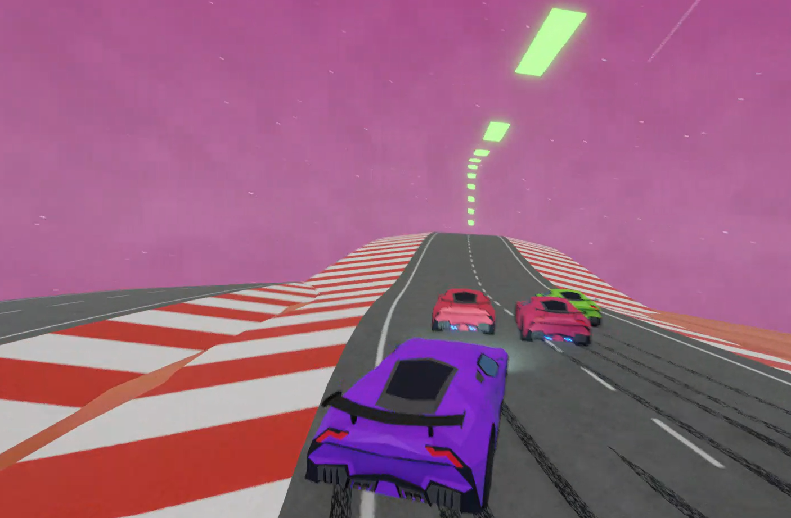
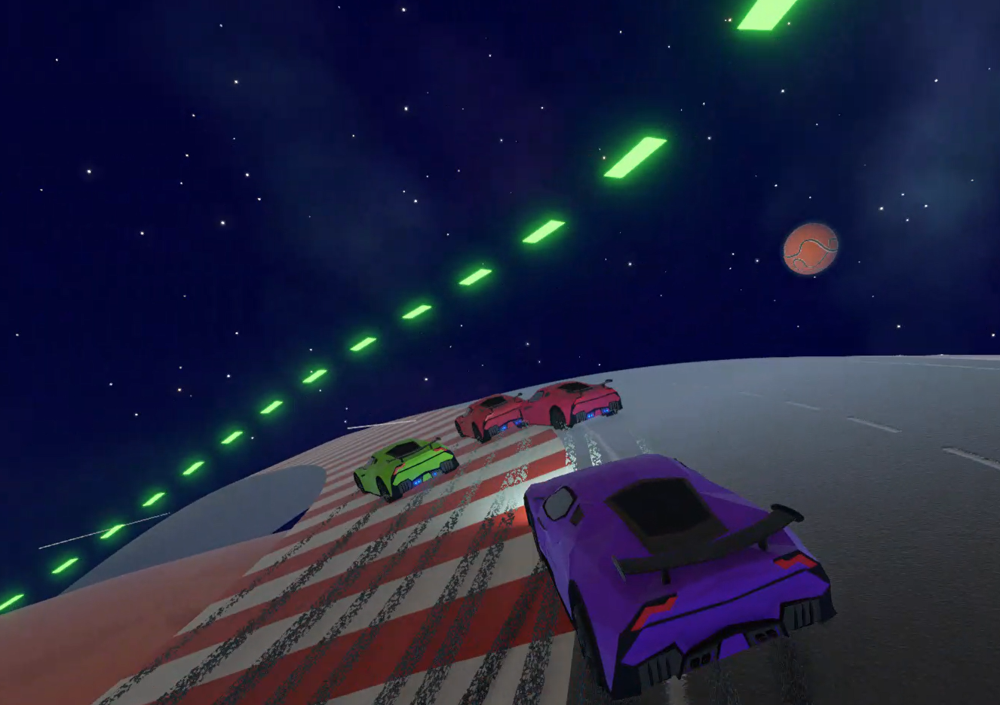
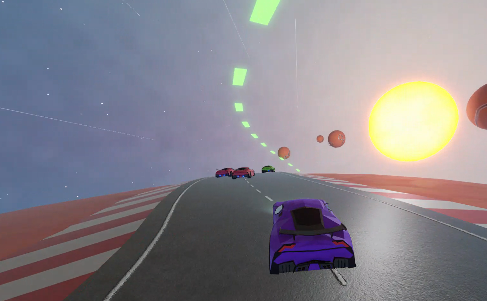

https://github.com/user-attachments/assets/a1c30cf9-63fa-473d-a2b5-86beaf7002a9

# Solar Sprint — 3D Racing Game Showcase

> **Note:** This is a public showcase repository for an indie 3D racing game currently in active development with a planned commercial release on Steam. The source code is kept private.

## Overview

A 3D arcade/physics racing game built in **Unity (C#)** where race tracks wrap seamlessly around the entire surface of small planets. Instead of driving on flat terrain, players navigate full 360-degree planetary loops with custom spherical gravity and dynamically generated track geometry.

## Gameplay Demo

https://github.com/user-attachments/assets/f85a5987-cea6-46e8-b5b2-5b8bef23a504

## Technical Highlights

* **Procedural 3D Track Generation (Bézier Curves):** Track meshes are generated procedurally in 3D space along Bézier splines wrapped around planetary surfaces, allowing smooth curvature, banking, and rapid iteration without manual 3D modeling of every track segment.
* **Custom Level Editor:** Built-in tooling designed for creating, shaping, and adjusting planetary race tracks directly in the workflow.
* **Custom Spherical Gravity & Vehicle Physics:** Replaced standard flat-world gravity `(0, -1, 0)` with a custom physics setup that continuously calculates gravitational pull toward the planet's center and dynamically aligns vehicle orientation to the local surface normal.
* **Custom Sky & Star Shaders:** Written custom shaders to render the planetary sky atmosphere and dynamic starfield environment.

## Tech Stack

* **Engine:** Unity
* **Language:** C#
* **Graphics:** HLSL, Unity Shader Graph
* **Core Concepts:** Procedural mesh generation, Bézier curves, 3D vector math, custom car physics

## Screenshots

 

## Project Status

**In active development.** Currently focusing on refining track generation tools, vehicle handling, and building core gameplay content toward a future Steam release.

---

**Author:** Dawid Deja — [GitHub](https://github.com/Deja7)
